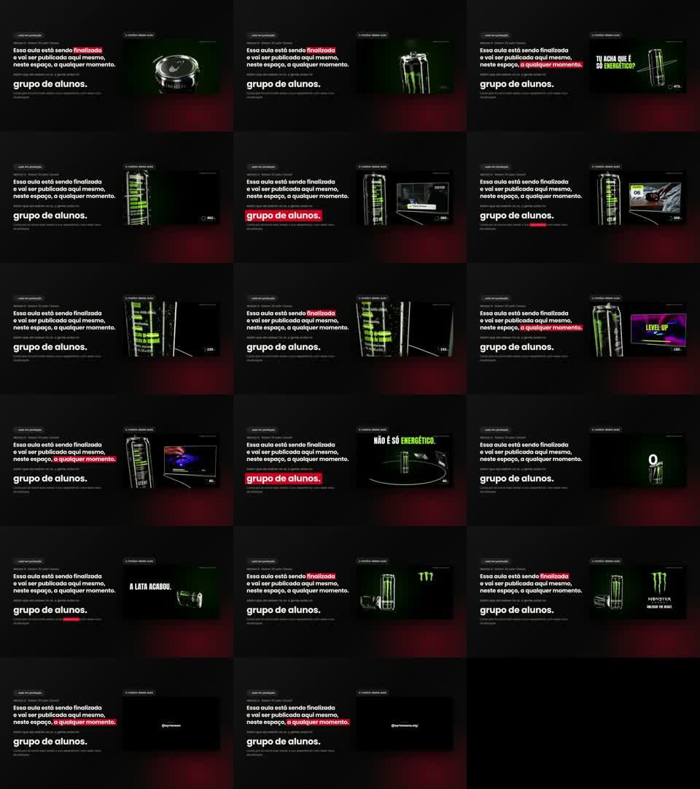

# 8.2 — Motion 3D pelo Claude

A cópia da aula tem 33,5 segundos e uma faixa de vídeo, sem faixa de áudio. Um aviso na tela informa que a aula prática estava sendo finalizada e seria publicada naquele espaço. O aviso também remete ao grupo de alunos. Esse é o estado registrado na gravação.

Ao lado do aviso aparece a peça de referência. A lata escura gira, o verde destaca o logotipo e as palavras, e as chamadas sobre os ingredientes se alternam com elementos gráficos de jogo, como o cronômetro e a mensagem “LEVEL UP”. No encerramento, a marca volta a ocupar o centro da composição.

Quem quiser estudar o ritmo pode comparar a abertura, as mudanças de ingrediente e o fechamento com a versão narrada da aula 8.1. O arquivo 8.2 permite observar o resultado visual. O passo a passo de produção não aparece nessa gravação.

